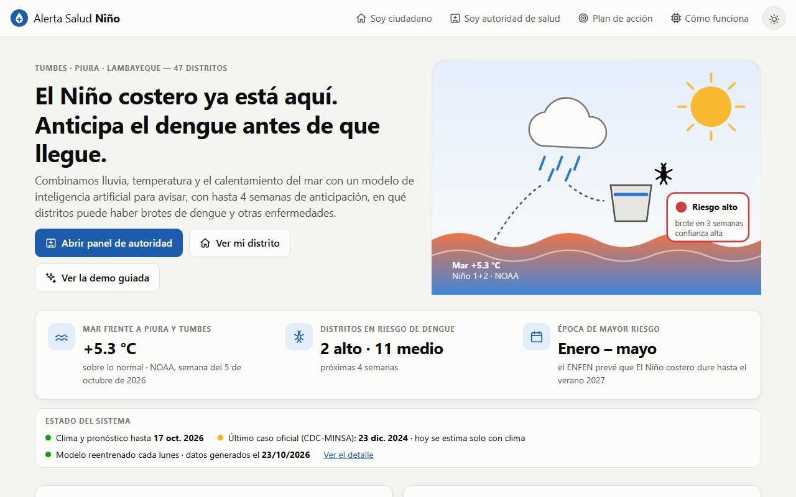
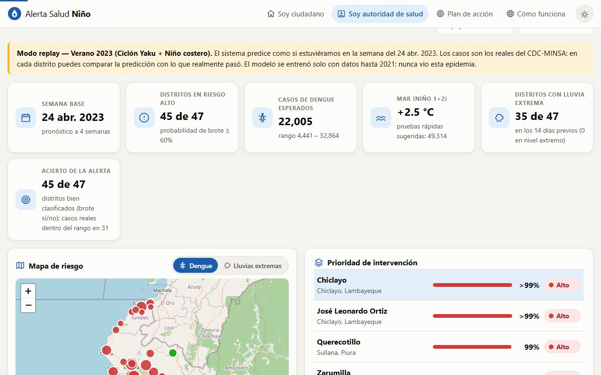
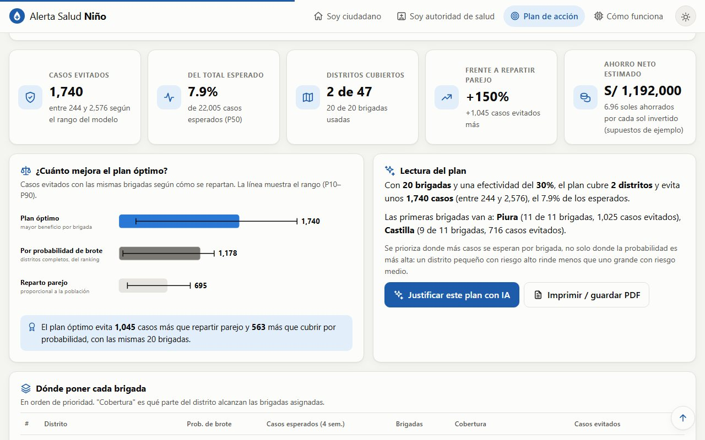
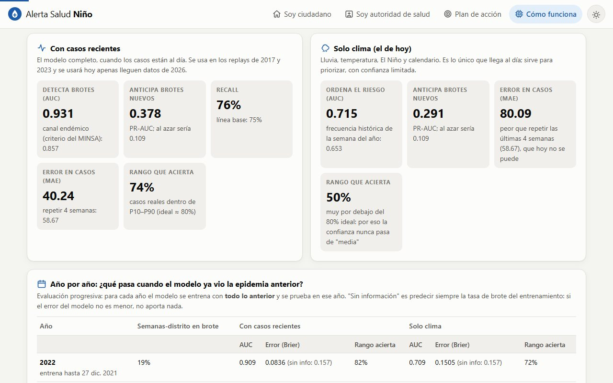
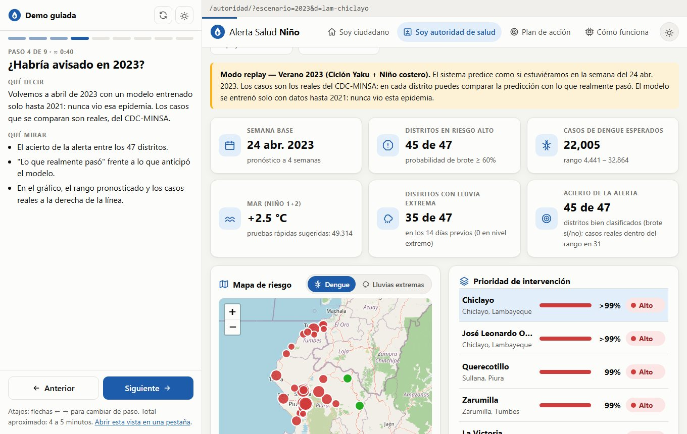
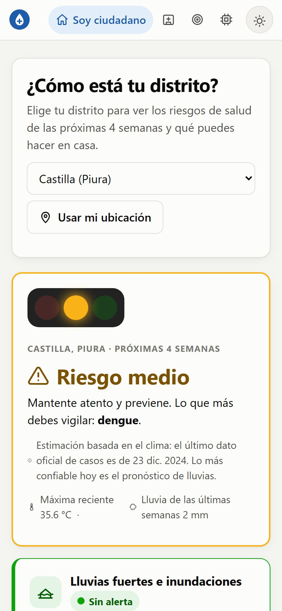
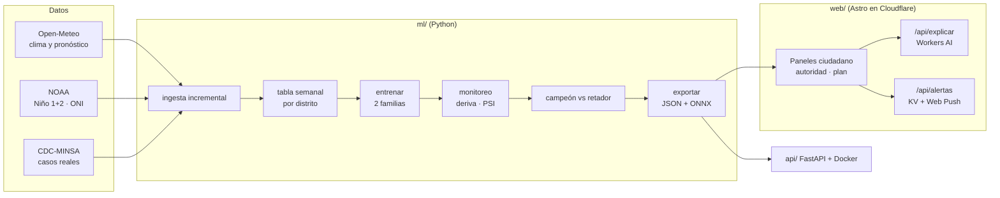

<div align="center">


# Alerta Salud Niño

**Anticipa el dengue antes de que llegue.**<br />
Alertas tempranas de dengue y enfermedades asociadas a El Niño costero para 47 distritos de Tumbes, Piura y Lambayeque.

[](https://alerta-salud-nino.marxchip99.workers.dev)
[](https://alerta-salud-nino.marxchip99.workers.dev/demo/)
[](https://alerta-salud-nino.marxchip99.workers.dev/construccion/)


<a href="https://alerta-salud-nino.marxchip99.workers.dev"></a>

[Qué hace](#qué-hace) · [Capturas](#capturas) · [Resultados](#resultados) · [Datos](#datos-qué-es-real-y-qué-es-simulado) · [Arquitectura](#arquitectura) · [Cómo correrlo](#cómo-correrlo) · [Uso responsable](#uso-responsable)

</div>

---

## Qué hace

Combina lluvia, temperatura y el calentamiento del mar con casos reales de vigilancia para **avisar con hasta 4 semanas de anticipación** dónde puede haber brotes, **con un nivel de confianza** y un **rango de casos**. Además avisa de **lluvias extremas** (inundación y huaico) y propone **dónde poner las brigadas** de control para evitar más casos.

| Para quién | Qué ve |
|---|---|
| **Autoridad de salud** (DIRESA, jefe de establecimiento) | Distritos priorizados por probabilidad de brote, casos esperados con rango, recursos sugeridos, mapa de dengue y de lluvias extremas, mapa de calor, comparación de temporadas y distritos, simulador "¿y si llueve como en 2023?", lectura de cada gráfico con IA e informe PDF. |
| **Plan de acción** (gestión) | Con N brigadas disponibles, ¿en qué distritos evitan más casos? Compara el reparto óptimo con repartir parejo o por probabilidad, con rango de incertidumbre y supuestos editables (efectividad, capacidad, costos). |
| **Ciudadano** | Semáforo de su distrito (enfermedades y lluvias extremas), sus riesgos principales, acciones simples, señales de alarma, asistente de prevención con IA e informe PDF. Puede **instalar la app en el celular**, usarla **sin internet** y **activar alertas** de su distrito. |

> **Pruébalo en 4 minutos:** abre la [demo guiada](https://alerta-salud-nino.marxchip99.workers.dev/demo/). Se abre en una ventana aparte con el guion a la izquierda y el sitio real a la derecha. Tiene 9 pasos, atajos con las flechas y reproducción automática.

## Capturas

<table>
  <tr>
    <td width="50%"><br /><sub><b>Replay de 2023.</b> El modelo, entrenado solo hasta 2021, frente a los casos reales del CDC-MINSA.</sub></td>
    <td width="50%"><br /><sub><b>Plan de brigadas.</b> Reparto óptimo contra repartir parejo, con rango de incertidumbre.</sub></td>
  </tr>
  <tr>
    <td width="50%"><br /><sub><b>Métricas honestas.</b> Con casos recientes y solo con clima, año por año.</sub></td>
    <td width="50%"><br /><sub><b>Demo guiada.</b> Guion de qué decir y qué mirar, junto al sitio real.</sub></td>
  </tr>
</table>

<p align="center"><br /><sub><b>Vista del ciudadano</b>, instalable en el celular.</sub></p>

## Resultados

Prueba **2022 a nov. 2024** con casos reales del CDC-MINSA, un periodo que el modelo no vio e incluye las epidemias de 2023 y 2024 (42,8% de las semanas-distrito en brote contra ~15% en el entrenamiento).

Hay **dos modelos**. Los casos oficiales llegan con meses de retraso (el último que tenemos es del 23 dic. 2024), así que el de **hoy usa solo clima**. El que usa casos recientes se aplica en los replays y cuando lleguen datos de 2026.

| Métrica | Con casos recientes | Línea base (canal endémico) | Solo clima (hoy) |
|---|:-:|:-:|:-:|
| AUC brote de dengue (4 semanas) | **0,931** | 0,857 | 0,715 |
| Recall | 76% | 75% | 17% |
| Error en casos (MAE) | 40,2 | 58,7 | 80,1 |
| Casos reales dentro del rango P10–P90 | 74% | — | 50% |
| PR-AUC anticipando un brote **nuevo** | 0,378 (azar 0,109) | — | 0,291 |

> [!IMPORTANT]
> Con casos recientes el modelo ordena bien pero **subestima** la intensidad de las epidemias grandes. **Solo con clima sirve para decidir qué distritos vigilar primero, no para calcular cuántos casos habrá**: su error de probabilidades es igual o peor que predecir la tasa base, por eso su confianza nunca pasa de "media". Detalle y evaluación año por año en [`ml/reports/model_card.md`](ml/reports/model_card.md).

- **Monitoreo y reentrenamiento:** el mar Niño 1+2 (+5,3 °C) está fuera del rango de entrenamiento (máx. 2,7 °C) y el monitoreo lo detecta. El retador compite en un año completo: con solo clima no mejora lo suficiente (2% < 5%) y se mantiene el campeón; con casos recientes mejora 18% y se promueve.
- **Lluvias extremas:** los días-distrito sobre el umbral extremo fueron 112 en 2017 y 45 en 2023 (año no usado para fijar los umbrales), frente a ~0 en años normales.
- **Rendimiento medido** (sitio publicado, CPU 4× más lenta): el panel carga en 3,0 s en 4G lenta (1,8 s sin limitar). Detalle en [Cómo se construyó](https://alerta-salud-nino.marxchip99.workers.dev/construccion/).

## Datos: qué es real y qué es simulado

| Tipo | Dato | Fuente | Hasta |
|:-:|---|---|---|
| Real | Dengue, diarreas (EDA), infecciones respiratorias (IRA), leptospirosis | **CDC-MINSA**, Plataforma Nacional de Datos Abiertos (ODC-By) | 23 dic. 2024 |
| Real | Dengue de Piura 2025–2026 (solo contexto, no entrena) | Gobierno Regional de Piura | 22 jun. 2026 |
| Real | Lluvia, temperatura y humedad diarias, pronóstico de 16 días | Open-Meteo (reanálisis ERA5) | hoy |
| Real | Anomalía del mar Niño 1+2 e índice ONI | NOAA CPC | hoy |
| Simulado | **Golpe de calor** (no hay fuente abierta) | Simulado a partir de la temperatura máxima real | — |

- **Año provisional descartado:** el último año del archivo nacional (2025) está incompleto (Piura: 1 117 casos contra 12 242 del Gobierno Regional), así que no se usa. Detalle en [`ml/reports/dataset_card.md`](ml/reports/dataset_card.md).
- **Supuestos del plan de brigadas** (efectividad 30%, 15 000 habitantes por brigada, costos de ejemplo S/ 10 000 por brigada y S/ 800 por caso): editables y a validar con la DIRESA.

## Arquitectura



<details>
<summary><b>Estructura del repositorio</b></summary>

```
ml/ (Python: solo entrena y exporta)
  ingest.py       → clima real (Open-Meteo) + El Niño (NOAA); descarga incremental (solo días nuevos)
  ingest_cases.py → descarga los casos reales del CDC-MINSA (solo si el archivo cambió)
  real_cases.py   → semanas epidemiológicas, cruce por UBIGEO, descarta el último año (provisional)
  build_cases.py  → tabla semanal de casos reales (+ golpe de calor simulado en simulate.py)
  features.py     → variables y objetivos (sin fuga de datos), canal endémico
  train.py        → GradientBoosting (brote) + cuantiles P10/P50/P90 (casos) + logística (otras 4)
  monitor.py      → deriva de datos (PSI), desempeño por trimestre, decisión de reentrenar
  retrain.py      → campeón vs retador sobre semanas que ninguno vio; promueve solo si mejora
  hazards.py      → índice de lluvias extremas (percentiles históricos de cada distrito)
  notify.py       → envía las alertas push a quienes las activaron (Web Push cifrado, firma VAPID)
  export.py       → web/public/data/*.json + modelos .onnx + api/models/

web/ (Astro 7 en Cloudflare Workers)
  /            inicio · /ciudadano · /autoridad · /plan · /modelo · /construccion · /demo · /reporte (PDF)
  /api/explicar  Workers AI (Llama 3.3 70B): explica distritos, gráficos, plan e informe; texto de respaldo si falla
  /api/alertas   guarda/borra suscripciones a alertas (Cloudflare KV): solo distrito + dirección técnica del navegador
  /sw.js         service worker: uso sin conexión + recepción de alertas · /manifest.webmanifest: app instalable
  scripts/smoke.mjs  prueba de humo del sitio publicado (páginas, datos, modelos, PWA e IA)

api/ (FastAPI + Docker)
  GET /health · /distritos · /metricas · /monitoreo   POST /predict · /predict/batch · /optimize
```

El modelo de **producción** (el retador promovido) predice "hoy" (solo clima mientras no haya casos recientes). Los replays de 2017 y 2023 usan el **campeón de evaluación**, entrenado solo con 2015–2021, que nunca vio esas epidemias.

</details>

## Cómo correrlo

<details open>
<summary><b>1. Pipeline de datos y modelo</b> (Python 3.12+)</summary>

```bash
cd ml
python -m venv .venv
.venv/Scripts/python -m pip install -r requirements.txt   # Linux/Mac: .venv/bin/python
bash run_pipeline.sh          # clima → casos → tabla de casos → entrenamiento → monitoreo → reentrenamiento → exportación
python -m pytest tests -q     # 38 pruebas del pipeline, los datos reales y las alertas
mlflow ui --backend-store-uri sqlite:///mlflow.db   # experimentos (también en reports/experiments.jsonl)
```

La API gratuita de Open-Meteo tiene límite por hora. La ingesta es **incremental** (la primera vez descarga toda la historia; después solo los días nuevos) y se reanuda sola si se corta. Los CSV del CDC-MINSA pesan unos 400 MB y solo se vuelven a bajar si cambian.

</details>

<details>
<summary><b>2. Sitio web</b> (Node 22+)</summary>

```bash
cd web
npm install
npm run dev        # http://localhost:4321
npm run build && npx wrangler deploy   # publica en Cloudflare (requiere `npx wrangler login`)
node scripts/smoke.mjs                 # prueba de humo del sitio publicado
```

Workers AI necesita una cuenta de Cloudflare (tiene capa gratuita). Sin ella, `/api/explicar` responde con una explicación armada con plantilla y la demo sigue funcionando. Ojo: Wrangler guarda el ID de cuenta en `web/node_modules/.cache/wrangler/wrangler-account.json`; revísalo si publicas desde otra cuenta.

</details>

<details>
<summary><b>3. API REST</b></summary>

```bash
cd api
../ml/.venv/Scripts/python -m uvicorn main:app --reload   # http://localhost:8000/docs
../ml/.venv/Scripts/python -m pytest -q                   # 19 pruebas
docker build -t alerta-salud-api . && docker run -p 8000:8000 alerta-salud-api
```

```bash
curl -X POST localhost:8000/predict  -H "content-type: application/json" -d '{"district_id":"piu-castilla","lluvia_pct":100,"temp_delta":1}'
curl -X POST localhost:8000/optimize -H "content-type: application/json" -d '{"escenario":"2023","brigadas":20,"efectividad":0.3,"costo_brigada":10000,"costo_caso":800}'
```

</details>

<details>
<summary><b>4. App instalable y alertas en el celular</b></summary>

El sitio es una **PWA**: en Android (Chrome, Edge o Samsung Internet) aparece el botón **Instalar app** en la barra superior; en iPhone el botón muestra los pasos (Compartir → Agregar a inicio). Instalada, abre a pantalla completa y **funciona sin internet** con los últimos datos guardados (probado apagando el servidor).

Las alertas usan **Web Push estándar** (no dependen de ninguna marca): en la vista del ciudadano se elige el distrito y se pulsa *Activar alertas*. Cada lunes, tras publicar, `ml/src/notify.py` avisa solo si el riesgo del distrito es **alto** (cada semana), **medio** (cuando sube) o **bajó** (una vez). En iPhone las alertas requieren la app instalada (iOS 16.4 o superior).

- **Privacidad:** solo se guarda el distrito y la dirección técnica del navegador; nada de nombre, teléfono ni ubicación. Se puede desactivar en cualquier momento.
- **Seguridad:** la API solo acepta direcciones de servicios de push conocidos (Google, Mozilla, Microsoft, Apple); el mensaje viaja cifrado y firmado (VAPID).
- **Claves:** la pública está en `web/src/lib/pwa.ts`. La **privada** se guarda como secreto `VAPID_PRIVATE_KEY` de GitHub y nunca en el repositorio. Si se cambia el par, hay que actualizar ambas y las suscripciones previas dejan de funcionar.
- **Prueba local:** `python ml/src/notify.py --dry-run --store-file subs.json` muestra qué se enviaría sin enviar nada.

</details>

<details>
<summary><b>5. Reentrenamiento semanal automático</b></summary>

`.github/workflows/retrain.yml` corre cada lunes: ingesta incremental de clima y casos, entrenamiento, monitoreo, campeón vs retador, tests y, solo si todo pasa, publica el sitio, corre la prueba de humo y envía las alertas. Necesita los secretos `CLOUDFLARE_API_TOKEN` y `CLOUDFLARE_ACCOUNT_ID` (y `VAPID_PRIVATE_KEY` para las alertas) en el repositorio. También se lanza a mano desde la pestaña Actions.

</details>

## Uso responsable

Es un sistema de **apoyo a la decisión**: no reemplaza la vigilancia epidemiológica ni los comunicados del MINSA y el ENFEN. La IA solo redacta explicaciones con los números del modelo; no diagnostica ni receta. No se usan datos personales: todo es agregado por distrito y semana.

## Licencia

[MIT](LICENSE). Los casos reales son del CDC-MINSA (ODC-By); el golpe de calor es simulado. El sistema es de apoyo a la decisión y no reemplaza la vigilancia oficial.
